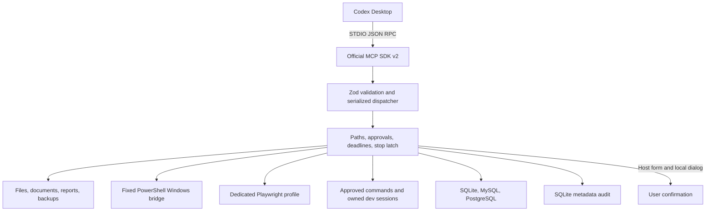

# Architecture

The current 3.0 additions, native Office worker, persistent queue, storage reservations and dashboard are described in [ULTIMATE-V3.md](ULTIMATE-V3.md). The diagram below documents the inherited modules; 3.0 allows two independent reads while serializing foreground mutations.

`src/server` owns tool registration and dispatch; individual modules return independent tool definitions. STDIO stdout contains MCP messages only. Diagnostics use stderr. SDK v2 serves both modern and legacy protocol peers; required approvals use the input-required flow and its legacy elicitation shim.

`src/config` loads strict local JSON policy. `src/security` handles canonical paths and persistent emergency stop. `src/audit` owns metadata-only SQLite audit. `.state` holds browser binaries/profile, audit, backups and stop state; ordinary tools cannot browse it. `workspace` is the initial authorized data directory. `logs`/`backups` are documented project directories; actual audit/backup storage is consolidated under protected `.state`.

The PowerShell adapter launches the fixed `windows-bridge.ps1` file with a validated operation and Base64 JSON payload. It never interpolates user strings into executable PowerShell. UI actions use Windows UI Automation patterns and window handles/process IDs. Document parsers use bounded file/ZIP sizes; format support is in FORMATS.md.

Commands and development sessions execute fixed locally configured executable/argv pairs; they do not implement arbitrary remote commands. SQLite work runs in a short-lived Node subprocess so native queries can be cancelled reliably. Remote SQL uses native read-only transactions and bounded result queries.

Source modules are TypeScript with strict checking, built to `dist`. Tests exercise actual disposable artifacts plus explicit adapters for actions that need a user's live Windows confirmation. No service installation, registry mutation, global package installation or administrator access is required.
